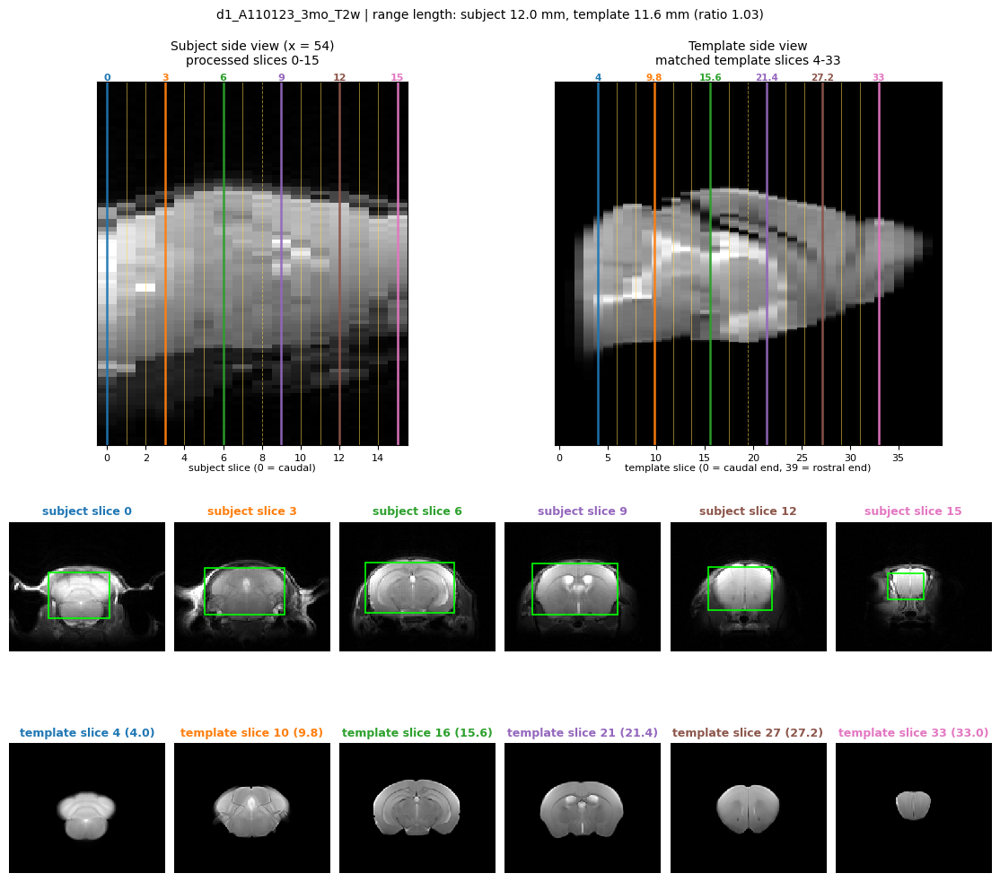
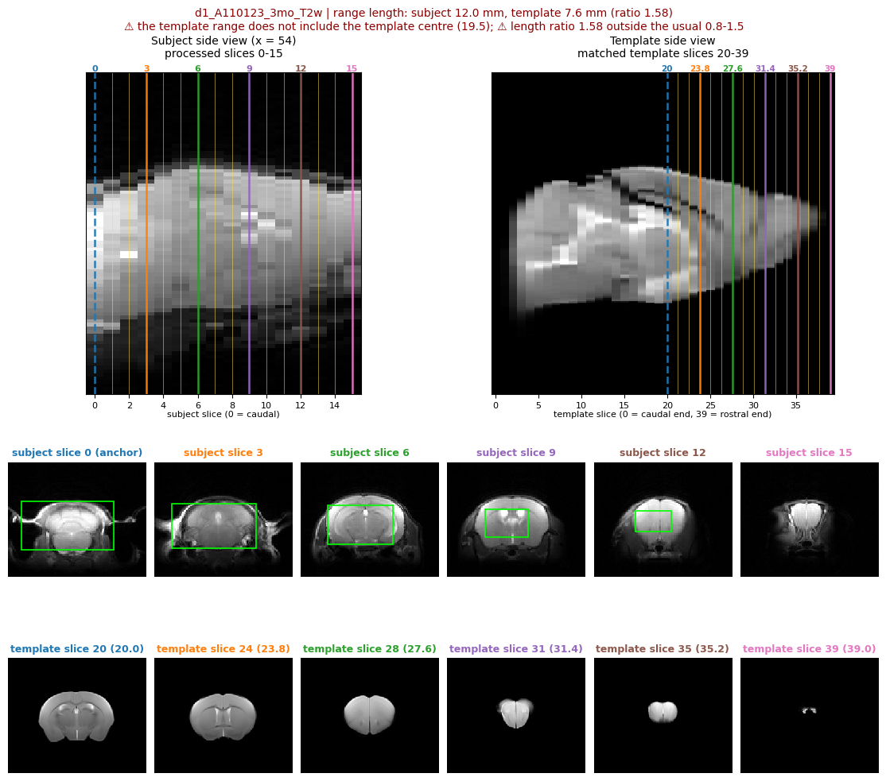

# Choosing the anteroposterior range

## Why it matters

SAMson prompts SAM with one box per coronal slice. It does not detect the brain in every slice: it finds the brain box
once, with median_otsu, in one slice (the **anchor slice**), and derives the box of every other slice from the shape of
the brain in the **template** at the matching position. So SAMson must know which template slice matches each slice of
your images. You give it two numbers, the template slices that match your **first** and your **last** processed slice;
the slices in between are matched linearly.

* Template slices go from 0 (caudal end: brainstem/cerebellum) to 39 (rostral end: olfactory bulbs), 0.4 mm apart.
* The anchor slice is the processed slice matched closest to the template's centre (template slice 19.5). Its brain
  box is taken as the box of the template's central slice (slice 20), and all box shapes are scaled from it.

A wrong range gives boxes of the wrong size or shape (for instance, a box that fits the olfactory bulb on a slice of the
cortex), and SAM then segments the wrong region.

## How to choose it

**With the app** (`samson app`, step 3): the page shows the side view of a representative image next to the side view of
the template, with the processed slices and their matched template positions, and below them pairs of coronal slices,
your slice above its matched template slice, with SAMson's box prompt in green. Move the sliders until each pair shows
the same anatomy and the boxes fit the brain. Warnings appear when the range looks implausible.

**Without the app**: `samson preview image.nii.gz --template A B` writes the same figure; try a few ranges.

**From manual masks**: if you have manual masks of a few subjects of the dataset, `samson suggest-range masks/*.nii.gz`
(or the app's *Suggest* panel) ranks the template ranges by how well SAMson's template boxes fit the boxes of your masks
(mean box IoU). On the article's datasets the best-ranked range is within 2 template slices of the range chosen by hand
(D1: 6–33 vs 4–33; D2: 3–38 vs 2–39; D3: 2–37 vs 3–35). Always check the suggestion visually.

### Example: a good and a wrong range

The example subject (article D1; 16 slices covering the whole brain) with the article's range, 4–33: each coloured pair
shows the same anatomy and the green boxes fit the brain.

The same subject with a wrong range, 20–39 (the rostral half of the template): the pairs do not match, the boxes shrink
towards the olfactory bulbs and vanish on the last slice, and the figure warns about the length ratio and the anchor.

## Rules of thumb

* **Whole-brain images**: the first processed slice is usually at template slices 2–5 and the last at 33–39 (article:
  D1 4–33, D2 2–39, D3 3–35).
* **Length**: the processed slices and the template range usually have similar lengths in mm: (number of slices − 1) ×
  slice spacing vs (last − first template slice) × 0.4 mm. In the article and benchmark data their ratio was 1.0–1.25.
  The app can keep this ratio for you (*Link the two range lengths*), so that you only move the range.
* **Images covering part of the brain** (e.g. 6 slices around the hippocampus): choose the template slices that show the
  same anatomy as your first and last slice. If the range does not include the template's centre (19.5), SAMson anchors
  the boxes on an end slice and the box sizes may be biased; prefer, if possible, a range whose anatomy includes
  template slices 19–20.
* **Slices without brain** at either end: leave them out with the slice range (`--slices`); they stay empty in the mask.
* **Header voxel sizes ×10** (common in rodent data converted for human software): this does not change the masks; set the
  header scale (app) or `--header-scale 0.1` (preview) only to get lengths in mm right.

## Examples

| Data | Slices | Template range |
|---|---|---|
| Article D1 (T2w, 16 slices of 0.8 mm, whole brain) | all | 4–33 |
| Article D2 (T2w, 22 slices of 0.7 mm) | all | 2–39 |
| Article D3 (T2w, 48 slices of 0.3 mm) | all | 3–35 |
| 6 slices of 1 mm from the midbrain (aqueduct) to the septum | all | 12–22 |
