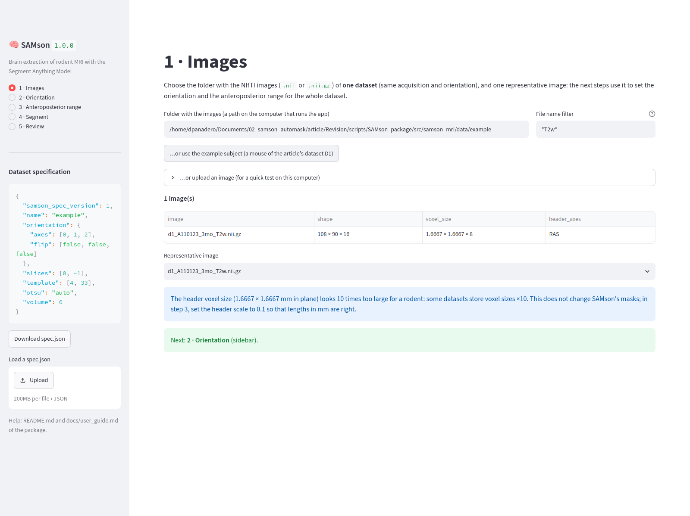
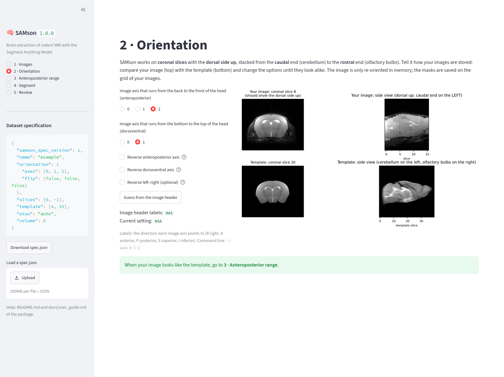
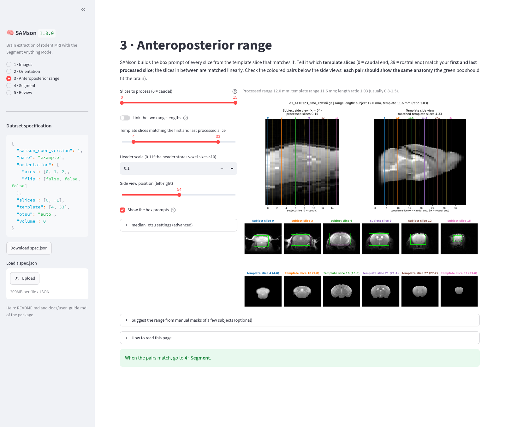
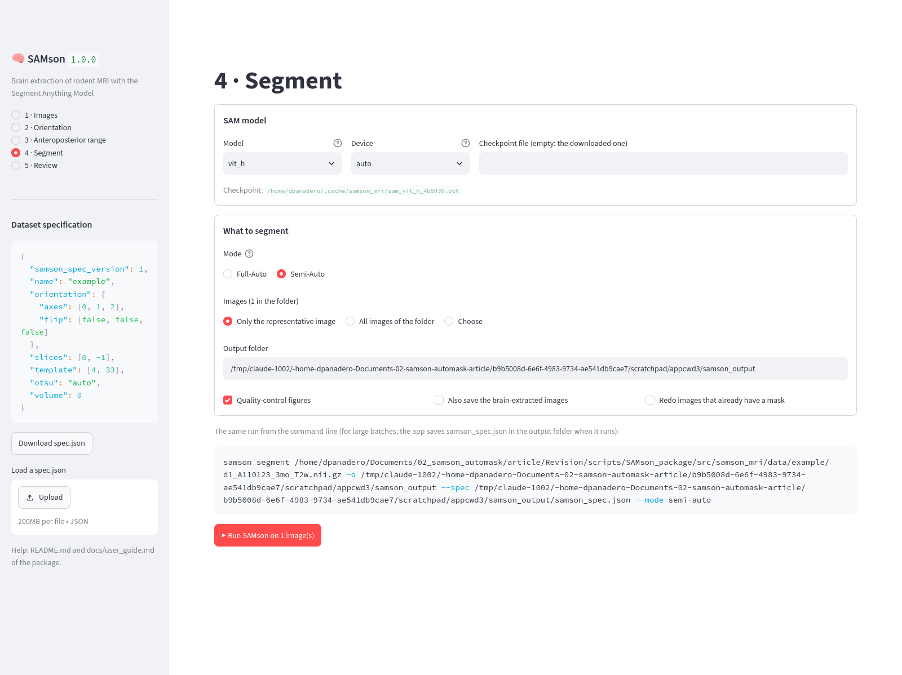
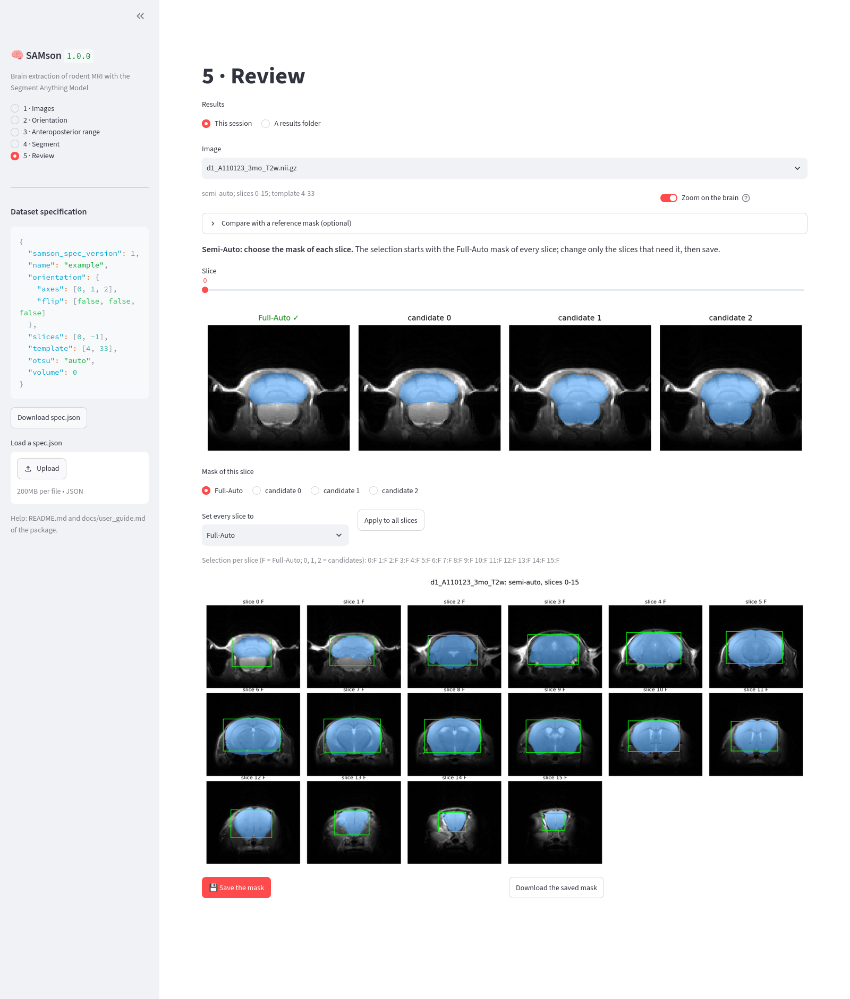

# SAMson user guide (no programming experience needed)

This guide takes you from nothing to brain masks of your own images. You type a few commands in a **terminal** (the
black window where you type commands; on Linux and macOS it is called *Terminal*, on Windows use *Anaconda Prompt*), and
then work in an **app** in your web browser.

## 1. Install (once)

You need **conda** (a program that installs Python and keeps each tool in its own *environment*, so that tools do not
interfere). If `conda --version` in a terminal prints a version, you have it; otherwise install
[Miniforge](https://github.com/conda-forge/miniforge).

```bash
conda create -n samson python=3.10 -c conda-forge     # 1. create an environment called "samson"
conda activate samson                                 # 2. enter it (do this every time you open a new terminal)
pip install /path/to/SAMson_package"[app]"            # 3. install SAMson and the app (from this folder; or "samson-mri[app]" from PyPI)
samson download-model                                 # 4. download SAM's model (2.4 GB, once)
samson example                                        # 5. check that everything works
```

Step 5 segments a mouse of the article and must end with
`identical to the article's published mask: yes` twice. `samson info` shows whether a GPU was found: with an NVIDIA GPU
a subject takes seconds; on the CPU it works but is much slower.

## 2. Prepare your images

* NIfTI files (`.nii` or `.nii.gz`), one per animal, **one folder per dataset** (same acquisition, orientation and
  slice coverage). Convert Bruker/DICOM data first (e.g. with `brkraw` or `dcm2niix`).
* 4D files (multi-echo, diffusion) are fine: you choose which volume to use.

## 3. Open the app

```bash
conda activate samson
samson app --folder /path/to/my/images
```

Open **http://localhost:8501** in a web browser. (On a remote server, first run `ssh -L 8501:localhost:8501 user@server`
on your own computer and keep it open; then open the same address in your browser.) To stop the app, press `Ctrl+C` in
the terminal.

The left bar shows the five steps and, below, the current **dataset specification** (all the settings of this
dataset), which you can download as `spec.json` and load again later.

### Step 1 · Images

Type the folder of the dataset (or press *use the example subject* to try the app with the article's mouse). The app
lists the images with their size and voxel size. Choose a **representative image** (a typical animal of the dataset):
the next two steps use it to set the orientation and the anteroposterior range for the whole dataset.



### Step 2 · Orientation

SAMson needs **coronal slices** with the **top of the head up**, ordered from the **back of the head (cerebellum) to the
front (olfactory bulbs)**. The page shows your image as SAMson will see it, next to the template:

* the **coronal view** must show the brain with the dorsal side up (as in the template);
* the **side view** must show the cerebellum on the **left**.

If not, change the options: which image axis runs from the back to the front of the head, which runs from bottom to top,
and whether to reverse them. Below the options, the page shows the axis labels of the image header (e.g. `RSP`: the image
axes point to the right, superior and posterior directions) next to the labels of the current setting. *Guess from the
image header* copies the header labels (often wrong for rodents: always check the views, and the coloured pairs of step
3). Your files are not changed: the masks are saved on the grid of your images.



### Step 3 · Anteroposterior range (the important step)

SAMson places its box prompt on each slice using the template slice that matches it. You tell it which **template
slices** (0 = caudal end, 39 = rostral end) match your **first and last processed slices**.

* Top: **side view of your image** (left) and **side view of the template** (right). The lines show the processed slices
  and where each one falls in the template; matching colours = matching slices.
* Bottom: **coloured pairs**: one of your slices (with SAMson's box prompt in green) above the template slice it is
  matched to.

Move the *Template slices* slider until **each pair shows the same anatomy and the green boxes fit the brain**. Also:

* *Slices to process*: leave out slices without brain at either end (they stay empty in the mask).
* *Link the two range lengths*: keeps the template range as long (in mm) as your slices, so you only slide it.
  Set the *header scale* to 0.1 if your header stores voxel sizes ×10 (the app tells you when it looks so).
* If you have manual masks of a few animals, *Suggest the range from manual masks* ranks the ranges for you.
* Above the figure, the lengths of both ranges (in mm, once the header scale is right) and warnings (yellow) that flag
  ranges that look implausible.



Typical whole-brain datasets use about 2–5 to 33–39. Images that cover only part of the brain need the matching part of
the template (e.g. 12–22 for 6 slices from the midbrain to the septum). More in
[anteroposterior_range.md](anteroposterior_range.md).

### Step 4 · Segment

* **Model**: keep `vit_h` (the article's) and `auto` device.
* **Mode**: *Full-Auto* gives one mask per slice. *Semi-Auto* also keeps SAM's three alternative masks of every slice, so
  that in step 5 you can replace the mask of any slice that is wrong.
* **Images**: only the representative image (to test), all the images of the folder, or a selection.
* **Output folder**: where the masks go (by default `samson_output` inside the image folder).

Press **Run SAMson**. Images that already have a mask in the output folder are skipped (tick *Redo* to overwrite). The
page also shows the **command line** that does the same run, useful for large batches (step 5 below).



### Step 5 · Review

Choose an image: the page shows every processed slice with its mask (blue) and box (green). In **Semi-Auto** mode, move
the *Slice* slider to a slice, look at the four options (the Full-Auto mask and SAM's candidates 0, 1, 2) and click the
best one; *Set every slice to* changes all slices at once. Press **Save the mask** when done. *Zoom on the brain* (on by
default) shows only the region around the brain, which helps when the brain is small in the image. With *A results folder*
you can review results of earlier sessions or of the command line. With *Compare with a reference mask* you get the
Jaccard index and Dice coefficient against a manual mask, and the reference is drawn in yellow.



## 4. Your results

In the output folder, for each image `<name>.nii.gz`:

* `<name>_mask.nii.gz`: **the brain mask** (1 = brain, 0 = background), aligned voxel by voxel with your image; open
  both in a viewer (ITK-SNAP, FSLeyes, 3D Slicer...) to check them;
* `<name>_qc.png`: a picture of every slice with its mask, for a quick check;
* `<name>_samson.json`: all the settings used (keep it: it documents how the mask was made);
* `<name>_candidates.nii.gz` (Semi-Auto): the alternative masks;
* `samson_spec.json` and `samson_summary.csv`: the settings and a table of the run.

## 5. Large batches: the command line

Once a dataset is set up in the app, the same settings segment any number of images without the app:

```bash
conda activate samson
samson segment /path/to/images -o /path/to/masks --spec /path/to/masks/samson_spec.json
```

Useful options: `--mode semi-auto`, `--pattern '*T2w*'` (only some files), `--overwrite`, `--no-qc`, `--save-brain`,
`--device cpu`. `samson segment --help` lists them all. `samson preview <image> --spec spec.json` makes the step-3
figure without the app; `samson select <name>_samson.json --choices ...` changes a Semi-Auto selection;
`samson evaluate` compares masks with manual ones.

## 6. Problems?

| Message or symptom | What to do |
|---|---|
| `samson: command not found` | `conda activate samson` (each new terminal) |
| `SAM's vit_h checkpoint was not found` | `samson download-model`, or `--checkpoint /path/to/sam_vit_h_4b8939.pth` |
| `the template range is required` | give `--template A B` or `--spec spec.json` (choose it in the app, step 3) |
| very slow | `samson info`: no GPU found. Use a computer with an NVIDIA GPU, or be patient |
| `samson info` says a GPU is present but PyTorch cannot use it | install a PyTorch build for your driver: `pip install torch torchvision --index-url https://download.pytorch.org/whl/cu121`, or `pip install -r requirements-lock.txt` |
| masks in the wrong place / upside down | the orientation (step 2) is wrong |
| boxes too small/large on some slices | the anteroposterior range (step 3) is wrong |
| one bad slice | Semi-Auto mode and pick another candidate in step 5 |
| `CUDA out of memory` | another program uses the GPU; close it or use `--device cpu` |
